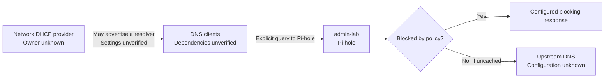

# DNS filtering on admin-lab

Pi-hole answers DNS queries and filters selected domains. DNS translates a name into an address; application traffic then travels to that address. A working DNS service therefore does not prove that a website or its Pi-hole dashboard works.

The solid client edge represents an explicit DNS test. It does not establish which devices normally use Pi-hole. DHCP can supply resolver addresses, but clients can also select their own resolver. Pi-hole's DHCP service was disabled at inspection; that does not identify the network's DHCP provider.

## Three checks answer different questions

| Check | What it establishes | What it leaves open |
|---|---|---|
| Container health | The configured health command passes | DNS from a client and browser access |
| Explicit DNS query | This client can query the selected resolver | The client's normal resolver and every other client |
| Dashboard request | The web endpoint responds on this path | DNS filtering and administrative authorization |

DNS answered during the 9–10 November checks. Browser access was reported unavailable on 11 November. Those observations can coexist. Current addresses and evidence belong in the [service register](../../_reference/services.md).

## DNS recovery starts with dependencies

A resolver restart can affect clients even while SSH works. Before maintenance, the operator needs to know which clients depend on this Pi, who supplies DHCP, and how to recover configuration. Those facts and a tested Pi-hole restore remain missing. The remote-lab backup workflow does not establish coverage for admin-lab.

[Check the service](../how-to/check-dns.md) without changing it. The shared [security explanation](../../../docs/explanations/security-and-access.md) distinguishes private maintenance access from DNS reachability.
