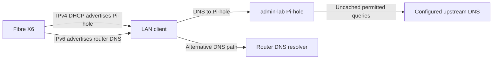

# DNS filtering on admin-lab

Pi-hole answers DNS queries and filters selected domains. DNS translates a name into an address; application traffic then travels to that address. DNS can return both IPv4 and IPv6 addresses over an IPv4 connection to Pi-hole.

## Automatic DNS has two paths

The Fibre X6 supplies Pi-hole's reserved LAN address through IPv4 DHCP. It also advertises its own IPv6 DNS resolver through router advertisements and DHCPv6. A client can therefore use Pi-hole or bypass it through the router.

The diagram shows available resolver paths, not a guarantee about which resolver a client selects. Explicit queries to Pi-hole passed. Test queries addressed to the router did not appear in Pi-hole's refreshed log. DHCPv4 configuration alone does not establish filtering for every client.

On 12 November 2026, Lloyd accepted working IPv4 DNS and stopped before any router console writes. IPv6 remains enabled, including its DNS bypass. The [service register](../../_reference/services.md#pi-hole-network-configuration) owns exact configuration and verification limits.

## Different checks establish different facts

| Check | What it establishes | What it leaves open |
|---|---|---|
| Container health | The configured health command passes | DNS from a client and browser access |
| Explicit DNS query | This client can query the selected resolver | The client's normal resolver |
| DHCP lease | The router supplied a DNS address | VPN overrides, IPv6 DNS, and application-specific resolvers |
| Query log | A particular query reached Pi-hole | Every other lookup and effective blocking policy |
| Dashboard login | The web endpoint and saved credential work | Configuration recovery after a rebuild |

A secondary public resolver can provide another path around filtering. A VPN can replace the default resolver even when Wi-Fi has Pi-hole configured. IPv4 DNS transport can resolve AAAA records, so filtering IPv6 destinations does not itself require a Pi-hole IPv6 listener.

## Recovery depends on configuration and access

The router reservation keeps the Pi-hole IPv4 address stable. Private maintenance SSH provides a separate administration path. A network lease change still needs console recovery because Tailscale depends on the host's underlying connectivity.

The existing Compose deployment and upstream DNS were identified, but persistent data and configuration restoration are not fully documented or tested. The remote-lab backup workflow does not establish coverage for admin-lab.

Use the [Pi-hole setup guide](../how-to/set-up-pihole.md) to configure the router and clients or [check the service](../how-to/check-dns.md) without changing it. The shared [security explanation](../../../docs/explanations/security-and-access.md) distinguishes maintenance access from DNS reachability.
