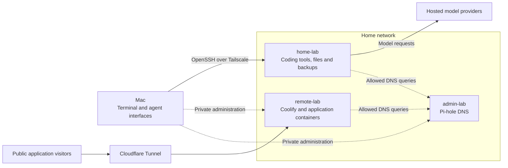

# Home-lab architecture

The Mac provides the interface; home-lab provides persistent compute and files. Agent tools, repositories, builds, and tests run under the HP's `coder` account. Model requests can go to hosted providers, so remote execution does not mean the model runs on the HP.

The two Pis keep their existing jobs. Remote-lab hosts public applications through Coolify, while admin-lab supplies Pi-hole DNS. This separates development from application hosting without moving working services during HP setup.

The diagram separates private management from public application traffic. Dashed DNS edges show policy permission, not verified resolver configuration. Tailscale grants control connectivity; application and SSH authentication remain separate checks.

## Work persists on the HP

A disconnected Mac does not inherently stop an HP process. Terminal managers preserve sessions across client disconnects, and systemd supervises selected background services. Neither restores a lost disk or recreates a process after every kind of failure. [Backup and recovery](backup-and-recovery.md) explains the separate data protection path.

Codex, OpenCode, T3, and Rex are interfaces to the same coding account, rather than separate security compartments. The installed tools have different verification histories. Their presence does not establish that every client, provider, and reboot path works. Current results belong in the [service register](../../_reference/services.md).

## Reviewable work has private URLs

The publishing service gives reports stable links and gives each browser-facing preview its own allocation. Applications listen on loopback; Tailscale Serve provides private HTTPS access. A restricted administrator helper manages those routes. Reports remain independent of preview cleanup and project Git history.

The [publishing guide](../publishing.md) owns operation. [Security and isolation](security-and-isolation.md) explains why private URLs do not constrain what a coding tool can do.

Hardware belongs in the [inventory](../../_reference/inventory.md). The [setup tutorial](../setup.md) connects the installation steps, while [preparation](../preparation.md) is the single list of unfinished HP work.
