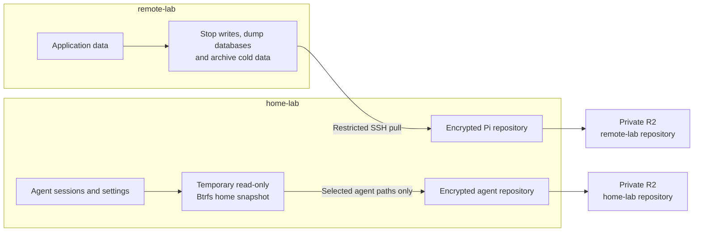
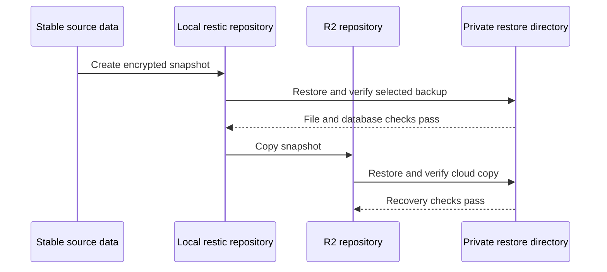

# Backup and recovery

Remote-lab backups preserve hosted application data. Home-lab backups preserve agent conversations and configuration. Separate repositories keep their scope and recovery paths distinct.

Encrypted local repositories avoid a cloud download for recovery. R2 adds an off-site copy within the Cloudflare account already used for hosting. HP root can access both copies' credentials; those credentials permit deletion. This is not immutable storage.

## Consistency depends on the source

The Pi exporter stops application writes, dumps PostgreSQL, and archives cold volumes and bind mounts. It restarts only originally running containers. This trades a nightly interruption for consistent application data. Images and writable container layers are excluded.

The HP job keeps agents running. A temporary read-only Btrfs snapshot freezes the whole home subvolume; only allowed agent paths are uploaded. Database files and journals remain together. Restored SQLite copies can recover committed journal data, though an application's multi-file operation may be incomplete.

## Scope is an explicit choice

Lloyd excluded project checkouts and worktrees from HP backups and relies on GitHub for project recovery. GitHub does not preserve uncommitted edits, unpushed commits, ignored project files, or local-only branches. Agent transcripts and attachments can still contain code and secrets.

Skill links need their omitted source checkouts restored at the original paths. Reports and preview records under `.local/share/lab-publish` are also excluded. Neither job is a complete HP machine image.

## A restore proves more than a successful upload

The diagram describes the initial recovery drills. Pi tests restored PostgreSQL clusters and checked SQLite data. HP tests checked agent databases and transcripts; an isolated Codex profile reopened one R2-restored conversation. Other agent interfaces and replacement-host authentication remain untested. Scheduled cloud checks do not repeat every interactive drill.

The policy retains 14 daily, 8 weekly, and 6 monthly snapshots. These sets overlap; the policy does not promise 28 distinct snapshots. Pi collection is scheduled at 02:00 and HP agent backup at 04:00, Europe/Zurich. Initial runs passed; future scheduled execution remains to be observed.

## Credentials and alerts have their own recovery needs

Backup credentials stay outside `coder`'s access. Recovery secrets are saved in 1Password; retrieval without either host is untested. Alerts use local journals and terminals. Email alerts are deferred, so an offline HP cannot report a missed run.

The [Pi backup guide](../../remote-lab/backups.md), [agent backup guide](../agent-backups.md), and [service register](../../_reference/services.md) own procedures, exact scope, and verification evidence. [Preparation](../preparation.md) owns unfinished work. The [recovery decision](../../../.okf/decisions/recovery-before-reliance.md) explains why restore tests precede reliance.
