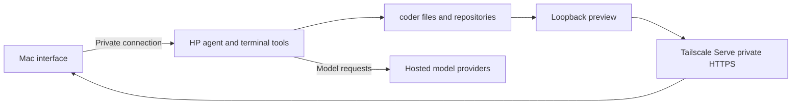

# The coding environment

The Mac provides the interface while home-lab retains files, builds, tests, and agent processes. Hosted providers supply model responses separately. This lets work continue when the client disconnects, provided the HP process stays running.

## Persistent sessions are not data recovery

Terminal managers preserve sessions across client disconnects. Systemd supervises selected background services. Neither restores a lost disk or guarantees recovery from every process failure. [Backup and recovery](../../../docs/explanations/backup-and-recovery.md) covers the selected agent data protected separately.

Codex, OpenCode, T3, and Rex use the same `coder` account. They share accessible files and credentials. Worktrees separate edits, not privileges. Their installed clients, provider sign-ins, and reboot paths have different verification histories, recorded in the [service register](../../_reference/services.md).

## Reviewable work has private URLs

Applications listen on loopback. Tailscale Serve provides private HTTPS routes through a restricted administrator helper. Reports have stable links independent of preview cleanup and project Git history. Their stored files are outside the accepted agent-backup scope.

The [publishing guide](../publishing.md) owns operation. [Security and access](../../../docs/explanations/security-and-access.md) explains why a private URL does not constrain the agent process. The [setup tutorial](../setup.md) connects installation tasks; [preparation](../preparation.md) owns remaining HP work.
