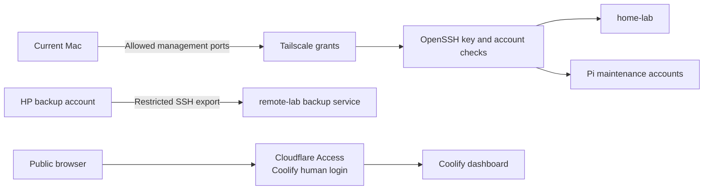
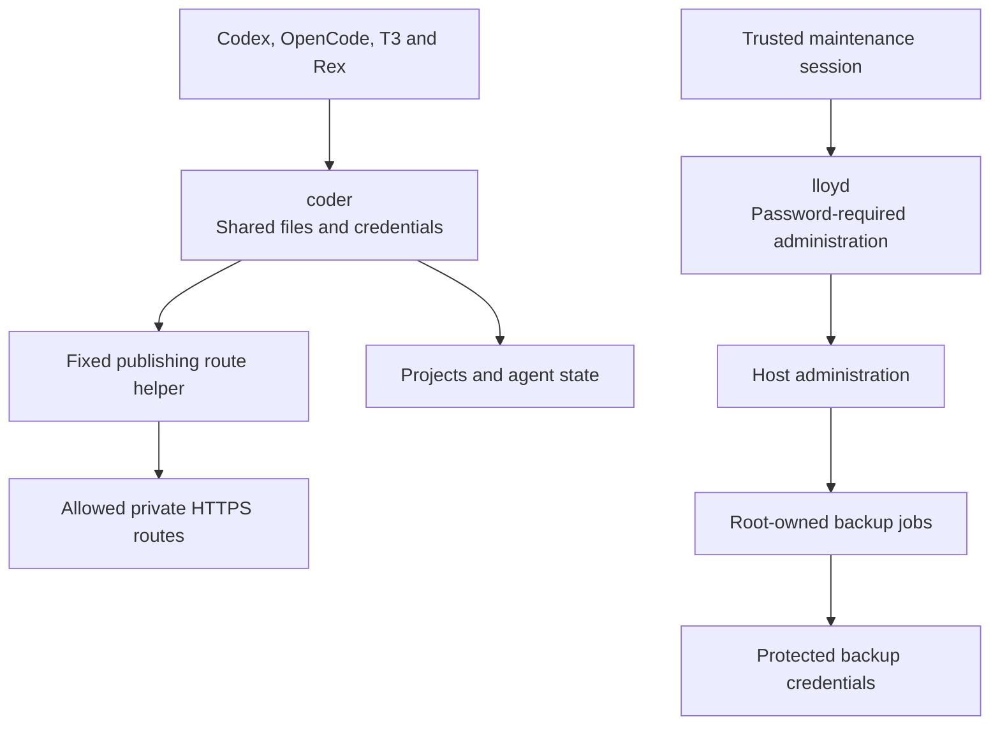

# Security and isolation

This setup separates network reachability, login authorization, and process authority. Each protects a different part of the system. A private connection does not make every tool reached through it safe.

## Network access controls who can connect

Tailscale grants restrict device-to-device traffic. OpenSSH then checks the authorized key and account. The current Mac is the maintenance client for both Pis; home-lab's coding account no longer has a Pi administrator key. The HP can reach remote-lab's separate backup SSH service, which accepts only its fixed export command.

This shows selected management paths, not every permitted connection. GitHub events use a separate path-scoped Access bypass. Application authentication and webhook signatures remain necessary. Exact grants and current evidence belong in the [access record](../../_reference/services.md) and [policy](../../_reference/tailscale-policy.json).

LAN access is a separate path. Further LAN firewall work is deferred, so Tailscale denial is not proof of denial from the home network.

## Account separation limits administration

`coder` has no general sudo or host Docker access. Its publishing exception accepts fixed route operations rather than arbitrary commands. Root-owned backup jobs retain host authority, including access to all coder files. Their allowlist limits what they upload; it does not restrict root. They do not give `coder` their R2 credentials.

All agents under `coder` still share that account's accessible files and credentials. Worktrees prevent some editing collisions; they are not security boundaries. HP project virtual machines are deferred. Local Mac VMs remain the chosen option for selected work requiring stronger isolation, without a verified combined workflow here.

## Hosting retains privileged components

Coolify keeps its root SSH deployment connection on remote-lab. The separate `coolify` host account has lost unrestricted sudo and Docker-group membership, but that does not remove Coolify's root authority. Caddy and Sentinel retain Docker socket access. A read-only socket mount does not provide read-only Docker API authorization.

Plastic Map and Outlier have separate Docker networks. Their working routes do not establish isolation from every host service or from the shared proxy. Further network separation and build-secret changes are deferred.

## Recovery limits the cost of mistakes

[Unattended boot](unattended-boot.md) retains a disk passphrase alongside TPM unlock. [Backups](backup-and-recovery.md) keep encrypted off-site copies and tested restore paths. Neither prevents an authorized administrator from damaging a running host. R2 write credentials can delete objects. HP root can access both local and cloud backup credentials, and the R2 copy shares the Cloudflare account used for hosting. The cloud copy adds an off-site location, not deletion resistance.

These boundaries are the current design, not a claim of complete isolation. Remaining work belongs in [preparation](../preparation.md); choices and alternatives remain in [agent isolation](../../../.okf/technologies/agent-isolation.md) and [private development](../../../.okf/decisions/home-lab/private-development.md).
