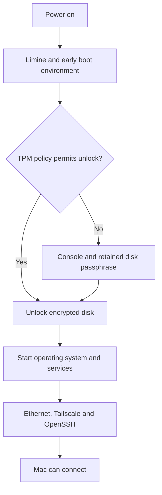

# Unattended boot and disk recovery

A headless HP must unlock its disk before networking and SSH can start. The installed system retains LUKS disk encryption and uses its TPM to unlock automatically. A separate disk passphrase remains the recovery path.

The disk-unlock key is sealed to the selected TPM policy. The early boot environment asks the TPM to unseal that key before mounting the encrypted root filesystem. The installed Limine and mkinitcpio integration supplies this early unlock support.

Networking arrives after disk unlock. A missing SSH connection can therefore be a boot or unlock problem, rather than a firewall problem.

## Availability and boot integrity are different goals

The installed enrollment uses PCR 7 while Secure Boot is disabled. A PCR is a TPM register that records a measurement. PCR 7 describes Secure Boot policy; it does not identify the kernel and early boot image.

This choice supports unattended startup and keeps an SSD removed from the HP encrypted. It does not establish that trusted boot software ran on a stolen whole machine. Stronger boot integrity would require a separately maintained Secure Boot and measured-boot policy. That work has not been applied.

Firmware and boot changes can alter measurements or remove required unlock support. The retained passphrase allows recovery when automatic unlock fails. TPM enrollment is hardware-specific, so restoring configuration files alone does not enroll a replacement machine's TPM.

## Boot recovery and data recovery remain separate

Omarchy's root snapshots can help recover an operating-system change. They do not protect `/home` from SSD loss. The [agent-state backups](../../../docs/explanations/backup-and-recovery.md) cover a selected part of that home data; project checkouts are excluded by choice.

Monitor-free cold startup passed on the installed HP. Overnight availability and AC-loss recovery remain separate checks. The [preparation checklist](../preparation.md) owns those gaps, and the [inventory](../../_reference/inventory.md) owns observed disk and boot facts.

The [TPM decision](../../../.okf/decisions/home-lab/unattended-boot.md) records the accepted tradeoff. [TPM research](../research/tpm-unlock.md) retains the version-sensitive source evidence and boot integration details. The [setup guide](../setup.md) links the operating procedures.
