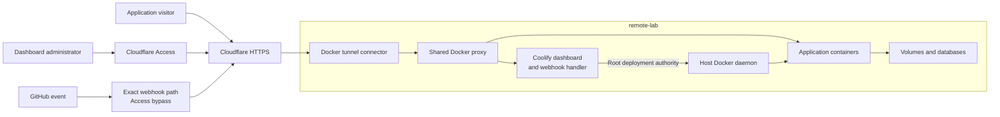

# Application hosting on remote-lab

Remote-lab keeps public applications separate from the HP coding environment. Coolify manages deployments and persistent storage on the Pi 5. Cloudflare Tunnel carries public requests to its Docker proxy without making SSH the public administration path.

The paths share infrastructure but require different checks. Access challenges human dashboard users. GitHub events bypass that browser challenge only at the event path; the handler still needs signature validation. Each application owns its login and authorization. A successful webhook ping proves reachability, not a signed deployment.

## Routing depends on Docker networks

The connector must resolve the proxy name on their shared network. The proxy must reach each app on its selected network. Plastic Map and Outlier have separate networks, while the proxy remains shared trusted infrastructure. A destination change can leave an old ingress label behind, producing HTTP 503 even when the app responds internally.

Public HTTPS and an HTTP tunnel origin can coexist. Dashboard redirect settings must match that path; redirecting the HTTP origin back to the same public HTTPS URL caused a loop. The [routing guide](../coolify-cloudflare.md) owns configuration and repairs.

## Deployment retains host authority

Coolify keeps its root SSH deployment connection. Removing the separate `coolify` host account's sudo and Docker-group membership did not remove that authority. Caddy and Sentinel also retain Docker socket access. A read-only socket mount does not restrict Docker API methods.

A container network reduces direct sharing between workloads. It does not isolate an app from every host service or protect it from a privileged deployment controller. Further separation and build-secret changes remain deferred. The [shared security explanation](../../../docs/explanations/security-and-access.md) describes the wider boundary.

## Data recovery is separate from redeployment

A source repository can recreate application code, but it does not contain uploaded files, database contents, or Coolify's encrypted credentials. Recovery needs persistent data, compatible database images, and the original Coolify `APP_KEY`. A destination clone copies configuration rather than application data.

The [backup reference](../reference/backups.md) defines the captured data. Initial data and credential drills passed, but complete restored dashboard operation and replacement-host cutover remain untested. The [service register](../../_reference/services.md) owns exact versions, routes, and observed results.
