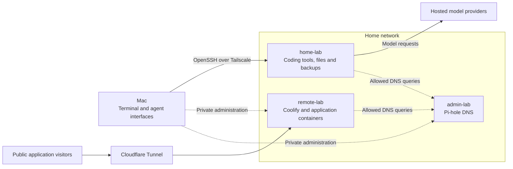

# Lab architecture

The Mac provides the interface; home-lab provides persistent compute and files. Agent tools, repositories, builds, and tests run under the HP's `coder` account. Model requests can go to hosted providers, so remote execution does not mean the model runs on the HP.

The two Pis keep their existing jobs. Remote-lab hosts public applications through Coolify, while admin-lab supplies Pi-hole DNS. This separates development from application hosting without moving working services during HP setup.

The diagram separates private management from public application traffic. Dashed DNS edges show policy permission, not verified resolver configuration. Tailscale grants control connectivity; application and SSH authentication remain separate checks.

## Each device has a separate recovery boundary

Home-lab hosts development, remote-lab hosts applications, and admin-lab supplies DNS. Keeping those roles separate avoids moving production services during development-host changes. It does not remove dependencies between them.

The HP collects remote-lab backups and copies them to R2. Losing the HP therefore affects both development and backup automation. [Backup and recovery](backup-and-recovery.md) explains the copies and limits. Admin-lab's actual DNS consumers and upstream resolver remain unconfirmed; a permitted DNS connection is not proof of dependency.

## Private management and public hosting use different paths

Mac maintenance reaches the hosts through OpenSSH over Tailscale. Public applications reach remote-lab through Cloudflare Tunnel and its Docker proxy. Cloudflare Access protects the Coolify human dashboard path. Application login and signed webhooks have separate checks.

[Security and access](security-and-access.md) explains the authorities on those paths. The [coding environment](../../devices/home-lab/explanations/coding-environment.md) explains HP sessions and private previews. The [device guides](../../README.md) lead to setup and operation, while the [inventory](../../devices/_reference/inventory.md) and [service register](../../devices/_reference/services.md) own current facts.
